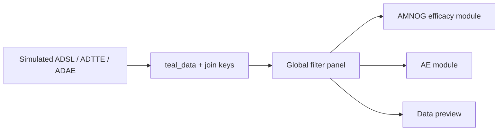

# AMNOG / G-BA Benefit Assessment Demo (teal)

An interactive [teal](https://pharmaverse.github.io/examples/interactive/teal.html) Shiny app that mimics key analyses from an **AMNOG benefit dossier (Module 4)** submitted to the German Federal Joint Committee (G-BA). It compares an intervention against the appropriate comparator therapy (*zweckmäßige Vergleichstherapie*, ZVT) using simulated CDISC ADaM data.

> **Disclaimer:** All data are simulated. Results have no clinical meaning. This is a teaching/demo tool and is not a validated system for regulatory submissions.

## Features

### Shared filter panel
All modules respond to one global filter panel (e.g. sex, age group, region), so every table and plot updates together.

### AMNOG benefit assessment (efficacy)
- Kaplan-Meier curves for overall survival by treatment arm
- Cox hazard ratios with 95% CI, overall and by subgroup (sex, age group, region)
- Interaction p-values per subgroup variable to flag effect modification (G-BA convention: p < 0.05)

### Adverse events (G-BA)
- Overview: any AE, serious AE (SAE), severe AE (CTCAE grade ≥ 3), discontinuation due to AE
- Grade ≥ 3 AEs by system organ class (SOC) and preferred term (PT)
- Patients with events: n (%) per arm, relative risk [95% CI], Fisher's exact p-value
- Adjustable incidence threshold for displayed terms

### Data preview
Built-in teal example module for browsing the underlying datasets.

## Data

| Dataset | Description | Key variables |
|---|---|---|
| `ADSL` | Subject-level (n = 400) | `STUDYID`, `USUBJID`, `ARM`, `SEX`, `AGEGR`, `REGION` |
| `ADTTE` | Time-to-event (overall survival) | `PARAMCD`, `AVAL` (months), `CNSR` |
| `ADAE` | Adverse events | `AEBODSYS`, `AEDECOD`, `AETOXGR`, `AESER`, `AEACN` |

Datasets are linked by `STUDYID` + `USUBJID` using `teal.data::default_cdisc_join_keys`.

## Getting started

### Requirements
- R ≥ 4.3
- Packages: `teal`, `survival`, `ggplot2`, `dplyr`

```r
install.packages(c("teal", "survival", "ggplot2", "dplyr"))
```

### Run the app

```r
shiny::runApp("teal_app")
```

The warning *"Automatic lockfile creation disabled"* is harmless; install `mirai` and `renv` to silence it.

## Project structure

```
teal_app/
├── app.R       # data simulation, custom teal modules, app definition
└── README.md
```



## Known limitations
- AE analyses use crude proportions; G-BA typically expects time-to-event analyses for AEs when observation times differ between arms.
- Relative risk is reported as "NC" when an arm has zero events (no continuity correction).
- No multiplicity adjustment for subgroup analyses.
- No IQWiG extent-of-benefit derivation yet.

## Roadmap

**Analyses**
- [ ] Time to first SAE / grade ≥ 3 AE (KM + HR).
- [ ] IQWiG extent-of-added-benefit classification (major / considerable / minor / non-quantifiable) by endpoint category, using CI upper-bound thresholds. 
- [ ] Morbidity and quality-of-life endpoints (e.g. EQ-5D VAS, EORTC QLQ-C30) with time to deterioration.
- [ ] Forest plot for subgroup hazard ratios.
- [ ] Continuity correction / exact methods for zero-event cells.
- [ ] AEs of special interest and non-severe AEs (grade 1–2).

**Engineering**
- [ ] Migrate to `teal.modules.clinical` / `tern` (`tm_g_km`, `tm_t_tte`, `tm_t_events`).
- [ ] Load real ADaM data (e.g. `random.cdisc.data` or `.sas7bdat`/`.xpt`).
- [ ] Split modules into separate files / package structure.
- [ ] Unit tests (`testthat`) and `shinytest2` UI tests.
- [ ] Reporter integration for exporting tables/plots (Word/PDF dossier-style).
- [ ] `renv` lockfile for reproducibility.
- [ ] Deployment to Posit Connect.

## Contributing
Issues and pull requests are welcome. Please describe the G-BA/IQWiG method reference when proposing new analyses.

## License
MIT (add a `LICENSE` file before publishing).

## References
- G-BA: Verfahrensordnung, Chapter 5 (benefit assessment of pharmaceuticals)
- IQWiG: *General Methods* (current version)
- CDISC ADaM Implementation Guide
- teal documentation: https://insightsengineering.github.io/teal/
